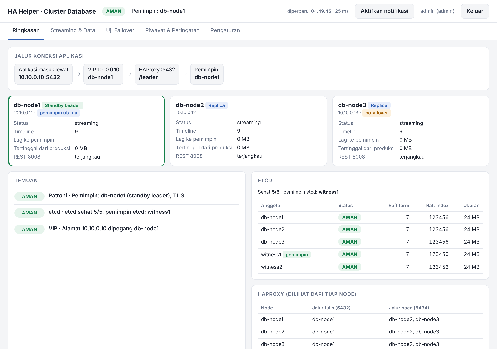

# HA Helper

Dashboard pemantau cluster **PostgreSQL HA** yang dibangun dengan
**Patroni + etcd + HAProxy + keepalived**. Dibuat untuk membantu admin saat
membangun, menguji, dan menjalankan redundansi database.

**Hanya membaca.** Dashboard tidak pernah mengubah apa pun di cluster maupun
di server sumber. Tanpa pustaka tambahan: cukup Python 3.8+.



## Fitur

| Tab | Isi |
|---|---|
| **Ringkasan** | Pemimpin, peran & lag tiap node, kesehatan etcd, server aktif di HAProxy tiap node, pemegang VIP, dan daftar temuan beserta perintah perbaikannya |
| **Streaming & Data** | Posisi tiap node terhadap server sumber; tombol cek yang menghitung data baru di sumber lalu mencocokkannya lewat jalur tulis & jalur baca cluster |
| **Cek Semua Tabel** | Hasil `linux/cek-semua-tabel.sh`: jumlah **dan isi** setiap baris di seluruh tabel, server sumber vs tiap node; COCOK / BERUBAH / AKTIF / BEDA / UNLOGGED, perkiraan sisa waktu, unduh CSV |
| **Backup** | Status pgBackRest (backup terakhir, full mingguan, isi NAS, retensi, log cron) dan arsip WAL; otomatis menilai stanza lama sebelum cutover dan stanza cluster sesudahnya |
| **Uji Failover** | Perekam keadaan cluster per detik selama uji: lama tanpa pemimpin, lama jalur tulis putus, lama koneksi gagal; laporan `.txt` siap dilampirkan |
| **Hari-H** | Daftar periksa pelaksanaan cutover: tiap langkah dicatat jam, nama pelaksana, bukti & catatan; indikator otomatis dari keadaan cluster; batas waktu jalan mundur; laporan `.txt` untuk atasan |
| **Konfigurasi Node** | Keseragaman konfigurasi antar node (hosts, etcd, Patroni, HAProxy, keepalived, pgBackRest, cron, ufw, NTP) dari pelapor di tiap node + pengaturan PostgreSQL pemimpin vs replica; BEDA / SALAH ditandai |
| **Riwayat & Peringatan** | Semua kejadian (pemimpin pindah, node keluar/masuk, VIP pindah, etcd bermasalah — kedipan sesaat dipisahkan), bunyi & notifikasi browser, email |

- Login dua peran: **admin** (akses penuh) dan **lihat** (hanya melihat).
  Salah sandi 5 kali → IP dikunci 5 menit.
- Bisa dipasang di **Windows** (PC admin) atau **Linux** (mis. VM witness, berjalan 24 jam).

## Mulai cepat

```bash
cp config.contoh.ini config.ini   # isi alamat node, etcd, VIP, sandi login [akses]
python3 jalankan.py --cek         # cek sekali di layar
python3 jalankan.py               # buka dashboard di http://127.0.0.1:8099
```

Panduan lengkap:
- [Pasang di Linux / witness (disarankan)](docs/PASANG-LINUX.md)
- [Pasang di Windows](docs/PASANG-WINDOWS.md)

## Yang dibutuhkan dari cluster

Komputer yang menjalankan dashboard harus bisa menjangkau:

| Tujuan | Porta | Untuk |
|---|---|---|
| Node database | 8008 | REST API Patroni |
| Anggota etcd | 2379 | Kesehatan etcd |
| Node database | 7000 | Halaman statistik HAProxy (`stats auth`) |
| HAProxy / VIP | 5432, 5434 | Jalur tulis & baca (cek data, uji koneksi) |
| Server sumber | 5432 | Hanya bila cluster masih standby dari server lain |

Arah sebaliknya (opsional): pelapor di tiap node mengirim ke dashboard lewat
porta **8099** (`linux/pasang-lapor.sh`, cron 5 menit, hanya membaca, tanpa sandi).

Untuk cek data, dashboard memakai pengguna PostgreSQL yang bisa membaca tabel
di `[tabel_cek_data]`. Disarankan membuat pengguna khusus yang hanya-baca.

## Struktur

```
jalankan.py            program utama
config.contoh.ini      contoh konfigurasi (salin menjadi config.ini)
hahelper/              kode: pgwire (klien PostgreSQL sendiri), collect, diagnose,
                       monitor, datacheck, recorder, konfig, backup, cekpenuh,
                       harih, auth, secret, server, web/
*.bat, windows/        skrip Windows (jalan manual / jalan terus di latar)
linux/                 skrip Linux (systemd, perintah ha-helper), pelapor node
                       (hahelper-lapor.py, pasang-lapor.sh), cek-semua-tabel.sh
data/                  dibuat otomatis: riwayat, laporan, sandi tersimpan (tidak di-upload)
```

## Keamanan

- `config.ini` dan `data/` ada di `.gitignore`: jangan pernah di-upload.
- Sandi cluster bisa dikosongkan di `config.ini` dan disimpan terpisah
  (Windows: terenkripsi DPAPI; Linux: berkas izin 600 milik pengguna layanan).
- Dashboard memakai HTTP biasa. Batasi akses porta 8099 dengan firewall hanya
  untuk komputer admin.

Riwayat perubahan: [CHANGELOG.md](CHANGELOG.md)
